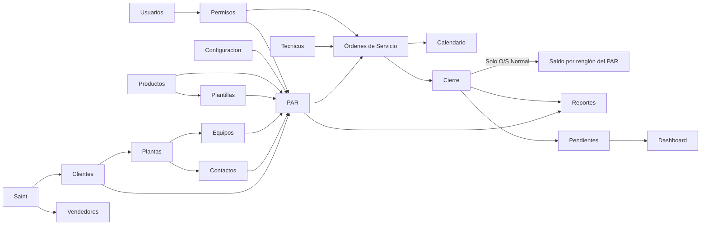

# Maquitech: dependencias e impacto de cambios

> Vigente. Revisión base: 22 de octubre de 2026; actualizado el 3 de noviembre: catálogo de vendedores.
> Leer después de [AI_CONTEXT.md](AI_CONTEXT.md). Índice completo: [docs](docs/README.md).

## 1. Eje del sistema

**PAR y O/S concentran las relaciones del negocio.** Un cambio de catálogo puede afectar selección y visualización; un cambio en PAR puede afectar presupuesto, programación, ejecución, cierre y reportes.

Las flechas expresan consumo funcional; no todas representan claves foráneas. Plantillas se copian al PAR. El calendario combina órdenes con períodos de no disponibilidad. [Relaciones físicas y snapshots](docs/arquitectura/datos-relaciones.md).

## 2. Mapa por módulo

| Módulo | Consume | Produce / persiste | Consumidores y efectos | Guía |
|---|---|---|---|---|
| Clientes / Saint | API Saint, configuración de integración | client, integration_sync_run; estado '1'/'0' | Plantas, contactos, equipos, PAR, O/S, importaciones, búsqueda, dashboard y reportes | [Catálogos](docs/modulos/clientes-plantas-contactos-equipos.md) |
| Vendedores | API Saint desde Configuración | vendor; integration_sync_run entidad Vendor; estado '1'/'0' | Consulta en `/vendedores`. No alimenta PAR, O/S ni comisiones. Una sincronización no borra ausentes | [Soporte](docs/modulos/dashboard-busqueda-perfil.md#vendedores) |
| Plantas | Cliente activo | plant, código por cliente | Contactos, equipos, PAR; O/S y reportes por relación | [Catálogos](docs/modulos/clientes-plantas-contactos-equipos.md) |
| Contactos | Cliente + planta compatible | contact, departamento, teléfono, correo | PAR y relación de O/S; búsqueda | [Catálogos](docs/modulos/clientes-plantas-contactos-equipos.md) |
| Equipos | Cliente + planta, datos técnicos | equipment, estado operativo | Selección PAR, selección y expediente O/S, calendario, dashboard, búsqueda | [Catálogos](docs/modulos/clientes-plantas-contactos-equipos.md) |
| Productos | Categoría, precios, indicador de técnico | product | Plantillas y nuevos renglones PAR; asignaciones conservan copias históricas | [Productos](docs/modulos/productos-plantillas.md) |
| Plantillas | Productos e ítems editables | par_template, par_template_item | Copia inicial de ítems PAR; no vínculo documental permanente | [Plantillas](docs/modulos/productos-plantillas.md) |
| PAR | Cliente, planta, contacto, equipos, productos, tasa, porcentaje de descuento, actor | par_header, par_equipment, par_item; subtotal, descuento, totales finales y budgeted_hours | O/S, reservas, cierre, reportes y búsqueda de órdenes | [PAR](docs/modulos/par.md) |
| O/S | PAR aprobado, equipos seleccionados, renglones, técnicos, horario | service_order, service_order_technician, service_order_equipment, asignaciones | Bloqueo/estado visible PAR, calendario, expediente, reportes, dashboard | [O/S](docs/modulos/ordenes-servicio.md) |
| Garantías | PAR aprobado + O/S Completada o referencia externa | Clasificación, origen, motivo y trabajos propios; estimaciones/reales independientes | Consulta e impresión, calendario, cierre y reportes separados; no consume presupuesto PAR | [Garantías](docs/modulos/garantias.md) |
| Horas | Cantidades PAR + asignaciones O/S + cierre | Estimaciones y reales por asignación; saldo calculado | Disponibilidad para otras O/S, justificación al cierre, reportes por técnico | [Horas](docs/modulos/horas-tecnicos.md) |
| Cierre | O/S En Proceso, equipos, técnicos programados, archivos, horas | Requisitos, metadatos, eventos, disco privado, closed_at/closed_by/actual_hours | Saldo, estado PAR, consulta histórica y reportes | [Cierre](docs/cierre-orden-servicio.md) |
| Fotos / pendientes | O/S, cliente/planta, técnico vinculado, sesión y cierre | service_order_photo, service_pending_item, service_pending_event; imágenes en disco privado | Expediente, publicación atómica al cierre, lista de seguimiento y resumen del dashboard | [Pendientes](docs/modulos/pendientes.md) |
| Técnicos / disponibilidad | Datos personales, usuario opcional, motivo y fechas, actor autorizado | technical, technical_unavailability, technical_unavailability_event | Bloqueo al programar O/S Normal/Garantía, agenda, tarjetas/tabla; categorías/notas privadas | [Técnicos](docs/modulos/tecnicos-calendario.md) |
| Calendario | O/S con aprobación registrada, horario, técnicos y períodos no cancelados | Consulta derivada de órdenes y no disponibilidad; sin edición de eventos | Planificación, advertencias de solapamiento | [Calendario](docs/modulos/tecnicos-calendario.md) |
| Usuarios y roles | Credentials, users/role, actor autorizado | Identidad, estado, rol, último acceso | Toda autorización; técnico vinculado y actores de auditoría | [Usuarios](docs/modulos/usuarios-configuracion.md) |
| Configuración | Datos de empresa, tasa, sincronización Saint de ubicación y vendedores | configuration singleton; country, state, city, vendor | Tasa copiada al PAR; datos de empresa leídos en documentos/reportes; vendedores solo se consultan | [Configuración](docs/modulos/usuarios-configuracion.md) |
| Importaciones | Excel + catálogos actuales + Superadministrador | Lotes/filas de análisis y cambios transaccionales de catálogos | Productos, plantas, contactos y equipos; alcance futuro del PAR | [Importaciones](docs/modulos/importaciones.md) |
| Reportes | PAR, PAR por mes, órdenes, clientes con conteos, agenda de técnicos y asignaciones de O/S cerradas + filtros + empresa | PDF temporal, sin historial persistente | Consulta de usuarios y entrega al cliente | [Reportes](docs/reportes.md) |
| Dashboard / búsqueda | Tablas operativas y catálogos | Consultas agregadas/resultados | Navegación y resumen; no son fuente de autorización | [Soporte](docs/modulos/dashboard-busqueda-perfil.md) |
| Perfil / notificaciones | Sesión y datos de demostración | Funcionalidad parcial descrita en guía | No existe automatización real del flujo PAR/O/S desde estos módulos | [Soporte](docs/modulos/dashboard-busqueda-perfil.md) |

## 3. Fuentes técnicas para evaluar impacto

| Área | Fuentes principales desde la raíz |
|---|---|
| Autenticación / acceso | `auth.js`, `proxy.js`, `lib/permissions.js`, `lib/repositories/user.repository.js` |
| Contratos compartidos | `lib/api.js`, `lib/validators/`, `lib/ui-errors.js`, `lib/status.js` |
| Consulta de contactos | `app/(dashboard)/contactos/page.jsx`, `components/catalog/ContactCardGrid.jsx`, `components/catalog/ContactConsultationModal.jsx`, `lib/repositories/contact.repository.js` |
| PAR | `lib/par-policy.js`, `lib/par-calculation.js`, `lib/repositories/par.repository.js`, `components/par/`, `hooks/par/` |
| O/S | `lib/service-order-policy.js`, `lib/repositories/service-order.repository.js`, `app/api/service-order/`, `components/service-orders/` |
| Horas | `lib/labor-hours.js`, `lib/repositories/service-order-labor.repository.js`, `lib/validators/operational.schema.js` |
| Garantías | `lib/warranty.js`, `lib/repositories/service-order-warranty.repository.js`, `WarrantySummary.jsx`, migración 057; repositorios de PAR/horas/cierre/reportes |
| Cierre | `app/(dashboard)/ordenes/[id]/page.jsx`, `components/service-orders/ServiceOrderClosure.jsx`, `lib/repositories/service-order-closure.repository.js`, `lib/repositories/service-order-equipment.repository.js`, `lib/validators/service-order-closure.schema.js` |
| Fotos / pendientes | `ServiceOrderFieldWork.jsx`, `lib/repositories/service-pending.repository.js`, `lib/service-pending.js`, `lib/validators/service-pending.schema.js`, `app/api/pending/`, `app/(dashboard)/pendientes/page.jsx`, `components/pending/`, `PendingDashboardCard.jsx`, migración 056 |
| Agenda | `lib/technician-calendar-policy.js`, `lib/repositories/technician-calendar.repository.js`, `app/api/technician-calendar/route.js` |
| Reportes | `lib/reports.js`, `lib/reports/pdf.jsx`, `lib/repositories/report.repository.js`, `lib/validators/report.schema.js` |
| Importación | `lib/import/`, `lib/repositories/data-import.repository.js`, `app/api/import/` |
| Datos / evolución | `lib/db.js`, `db/schema.sql`, `db/migrations/`, `scripts/apply-migration.mjs` |
| Vendedores | `lib/saint-api.js`, `lib/repositories/vendor.repository.js`, `app/api/vendor/`, `app/(dashboard)/vendedores/page.jsx`, `app/(dashboard)/configuracion/page.jsx`, migración 059 |

Las guías de módulo identifican las rutas específicas. No asumir que un componente existente sigue siendo el usado: seguir sus importaciones desde la página.

## 4. Impactos que requieren recorrer más de un módulo

| Cambio propuesto | Recorrido de revisión |
|---|---|
| Estado o identidad de cliente | Saint → relaciones de catálogo → creación/edición PAR → nuevas O/S → reportes con nombres actuales |
| Estado o datos de vendedor | Saint → `vendor` → consulta de `/vendedores`. No cambia PAR, reservas ni cierre |
| Mover planta, contacto o equipo | FK compuestas → referencias PAR/O/S → reglas de selección → importador; no basta actualizar un UUID |
| Consulta de contactos | GET del listado con cliente/planta por JOIN → página filtra y administra selección → fila/card/Ver contacto abren ContactConsultationModal. Editar utiliza el formulario existente y guardar recarga ambas vistas; el menú y los botones internos no propagan la activación de consulta. [Flujo completo](docs/modulos/clientes-plantas-contactos-equipos.md#consulta-compartida-desde-tabla-y-cards) |
| Consulta de pendientes | GET `/api/pending` con snapshots y alcance por actor → página conserva filtros/paginación del servidor → tabla o PendingCardGrid → mismo modal y PATCH de resolución con revisión. Cambiar vista solo modifica la preferencia local; no cambia permisos ni publica borradores. [Vistas de seguimiento](docs/modulos/pendientes.md#vistas-de-tabla-y-cards) |
| Categoría o requires_technician de producto | Catálogo/importador → plantillas → captura PAR → snapshot del renglón → presupuesto → asignaciones |
| Cantidad, retiro o sustitución de ítem PAR | Permiso de edición + existencia de O/S → presupuesto por identidad del renglón → snapshots históricos |
| Estado PAR | Política de transición → finalidad Comercial/ReferenciaGarantia → estado derivado y garantías abiertas → selección de PAR de O/S → reportes |
| Clasificación y origen de garantía | O/S Completada o referencia externa → mismo ámbito PAR → equipos y trabajos propios → horas independientes → expediente → reportes por clasificación. Finalidad/origen inmutables; un PAR de referencia solo admite garantías. Entrada desde completada fija clasificación/origen/PAR; referencias comerciales excluidas de formulario, consulta e impresión y protegidas en repositorio |
| Descuento PAR | Porcentaje de cabecera → validadores/formulario → recálculo SQL → subtotal/descuento/total final → consulta, tarjetas, impresión y reporte; horas y O/S mantienen sus cálculos |
| Consulta y trabajos del PAR | Clic en fila/tarjeta o Ver PAR → mismo ParConsultationModal → GET de detalle → ParPreview compartido; cada par_equipment.observaciones se muestra junto a su equipo. Gestionar PAR navega al detalle; la impresión conserva ParPrintSheet |
| Técnicos, equipo u horario de O/S | Pendiente → reparto entre 1 y 4 personas, incluido responsable → aprobación/conflictos → calendario, cierre, vistas y reporte. MAX_SERVICE_ORDER_TECHNICIANS coordina UI/API/repositorio; trigger SQL requiere migración 054 |
| Disponibilidad del técnico | Motivo/fechas → validación/repositorio → bloqueo compartido con O/S → catálogos/selectores → tabla/cards/modal y agenda. Migración 058 renombra tablas/FK; preservar IDs y snapshots, omitir categoría/notas para Coordinador y todas las agendas |
| Cancelar o cerrar O/S | Crear Expediente solo abre la preparación; Cerrar O/S al final confirma requisitos/horas → bloqueo PAR → consumo por renglón → disponibilidad para otras órdenes → estado visible PAR → reportes. Cancelar libera su reserva normal; las garantías no alteran saldo comercial |
| Cambiar qué significa una hora | PAR.qty → allocation.hours → allocation.actual_hours → cierre → saldo → PDF/CSV/UI; agenda es otra medida |
| Cambiar permisos | Registro de páginas/APIs → sesión → validaciones por acción → menú → agenda propia → consultas auxiliares |
| Cambiar almacenamiento | Metadatos + storage_key + hash → lectura/descarga → cierre → respaldos y restauración |
| Renombrar o eliminar campos | SQL y migración → repositorio → Zod/API → cliente → formulario/vista/impresión → reportes → documentación |

## 5. Datos compartidos y concurrencia

- Los valores actuales de catálogos y las copias históricas coexisten. El detalle de cada uno está en [datos y relaciones](docs/arquitectura/datos-relaciones.md).
- PAR y O/S coordinan escrituras mediante transacciones y bloqueo del PAR antes de la orden. Una validación de saldo previa en pantalla no garantiza saldo al guardar.
- Disponibilidad y programación comparten bloqueo transaccional por técnico; una previsualización de coincidencias no reserva fechas. Reprogramar una Aprobada conserva auditoría y exige nueva aprobación. [Reglas](docs/modulos/tecnicos-calendario.md#bloqueo-de-os-y-reprogramación).
- El expediente añade `closure_revision`: un conflicto exige releer y reconciliar; no reintentar silenciosamente sobrescribiendo.
- Los reportes usan una lectura consistente; descargar reutiliza los bytes mostrados.
- Saint serializa sincronizaciones; importación bloquea el lote y confirma todos los cambios juntos.
- No existe una auditoría universal de todos los CRUD: registrar solo las trazas realmente presentes.

## 6. Documentos que actualizar junto a cambios futuros

Actualizar la guía dueña de la regla; ajustar este mapa cuando cambien productores/consumidores y el contexto cuando cambien invariantes. Cambios de datos requieren revisar la guía de relaciones; permisos, su matriz; archivos y migraciones, operación. Mantener enlaces y diferenciar pendientes de comportamiento implementado.

[Procedimiento documental](docs/mantenimiento-documentacion.md) · [Observaciones verificadas](docs/pendientes-documentados.md)
