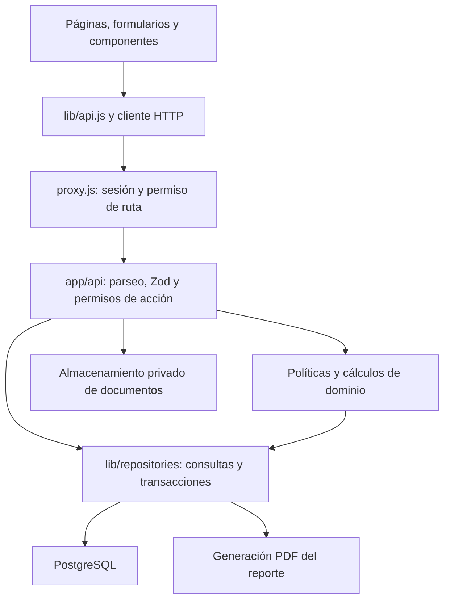

# Arquitectura y contratos

> Vigente · revisión estática: 22 de octubre de 2026. [Índice](../README.md)
> Fuentes: package.json, app/, lib/api.js, lib/axios.js, auth.js, proxy.js, lib/db.js y repositorios.

## Capas

Los cálculos compartidos también se usan en UI para anticipar resultados. El servidor conserva la validación decisiva; no confiar en totales o relaciones enviados por el navegador.

## Estructura práctica

| Directorio / archivo | Responsabilidad |
|---|---|
| app/(dashboard)/ | Pantallas operativas y rutas de navegación |
| app/api/ | Route Handlers; respuestas HTTP y validación de entrada |
| components/ui/ | Componentes y convenciones visuales compartidas |
| components/par/, hooks/par/ | Captura, consulta y composición PAR |
| components/service-orders/ | Programación, reparto, revisión y cierre O/S |
| components/reports/ | Filtros y visor/descarga de reportes |
| lib/api.js / lib/axios.js | Contrato frontend, timeout y errores HTTP |
| lib/validators/ | Contratos Zod de entrada |
| lib/repositories/ | SQL parametrizado y persistencia |
| lib/*policy.js | Reglas de transición, acceso a acciones y agenda |
| lib/db.js | Pool pg y helpers query/withTransaction |
| db/ | Esquema consolidado, evolución y validación |
| scripts/ / spec/ | Herramientas operativas y comprobaciones existentes |

## Dependencias de runtime

Las versiones declaradas viven en `package.json` y las resueltas en `package-lock.json`; no mantener otra lista de versiones que diverja.

- Next.js App Router y React, con JavaScript.
- NextAuth Credentials/JWT y bcryptjs para autenticación.
- pg para PostgreSQL; SQL directo sin ORM.
- Zod, React Hook Form y resolvers para validación/formularios.
- Axios para HTTP; Zustand para estado donde se utiliza.
- Tailwind, Framer Motion, Lucide y componentes propios para UI; Recharts donde esté integrado.
- FullCalendar React y temporal-polyfill para agenda.
- ExcelJS para importaciones.
- @react-pdf/renderer para generación de PDFs en Node.

La aplicación usa Next 16 con convenciones específicas: leer `node_modules/next/dist/docs/` antes de código relacionado. `proxy.js` es la protección vigente; las rutas dinámicas resuelven `params` de forma asíncrona.

## Persistencia y consistencia

`lib/db.js` centraliza conexiones y transacciones. No repartir una operación atómica entre llamadas que usen clientes distintos. Las familias críticas coordinan:

| Operación | Mecanismo |
|---|---|
| Editar PAR / crear o cambiar O/S | Bloqueo del PAR antes de validar dependencias y saldo |
| Cambiar/cerrar O/S | PAR → O/S; transacción compartida |
| Modificar expediente | Bloqueos más closure_revision para detectar vista desactualizada |
| Reporte | REPEATABLE READ, READ ONLY; detalle y totales en la misma lectura |
| Saint | Transacción y bloqueo asesor de sincronización |
| Importar | Bloqueo del lote, cambios y resultado en una transacción |

No extrapolar estos mecanismos a todos los CRUD. La documentación describe su uso donde existe.

## Errores y contratos

Las rutas traducen errores de validación, permiso y dominio a HTTP. `lib/ui-errors.js` y el cliente HTTP separan mensajes públicos de detalles internos. Metadatos HTTP usan nombres como `httpStatus` para no sobrescribir un campo de negocio llamado `status`.

Al cambiar un campo, recorrer formulario → lib/api → Route Handler → Zod → repositorio → SQL y todos los lectores (vista, impresión, exportaciones, reportes). El render exitoso de una pantalla no demuestra persistencia; existen módulos parciales.

## Archivos y PDF

Documentos de cierre: archivo persistente privado + metadatos/hash/auditoría en base. Reportes: PDF generado en servidor para una consulta y Blob temporal en navegador. No comparten ciclo de vida ni política de respaldo.

Fuentes especializadas: [cierre](../cierre-orden-servicio.md), [reportes](../reportes.md), [datos](datos-relaciones.md), [operación](../operacion/despliegue-respaldo-migraciones.md).
