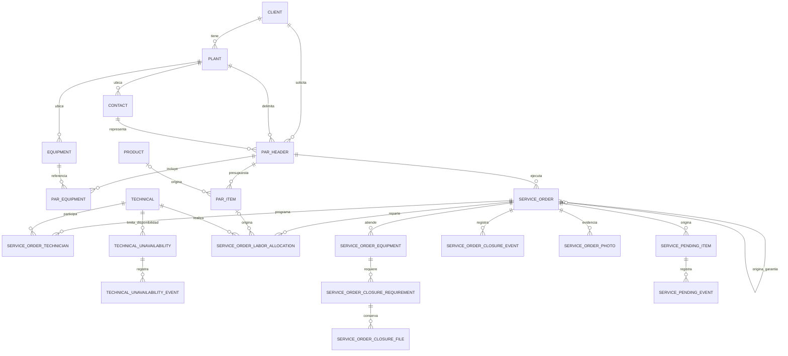

# Modelo de datos y conservación de relaciones

> Vigente · actualizado el 31 de octubre de 2026: garantías y períodos de no disponibilidad. [Índice](../README.md)
> Fuentes: db/schema.sql, migraciones 031–059 y repositorios. El SQL versionado describe estructura; no confirma qué migraciones tiene una instalación.

## Entidades centrales

Diagrama conceptual: no sustituye todas las restricciones SQL. El mínimo operativo de una selección puede ser más estricto que la cardinalidad física.

## Inventario por responsabilidad

| Grupo | Tablas / propósito |
|---|---|
| Identidad | role, users; technical.user_id opcional y único |
| Ubicación e integración | country, state, city; client; vendor; integration_sync_run |
| Catálogos operativos | plant, contact, equipment, product, technical |
| Disponibilidad y reprogramación | technical_unavailability, technical_unavailability_event; service_order_schedule_event y schedule_revision conservan cambios autorizados de O/S |
| PAR | par_header, par_equipment, par_item |
| Plantillas | par_template, par_template_item; se copian al crear contenido PAR |
| Ejecución | service_order, service_order_technician, service_order_labor_allocation |
| Alcance y cierre | service_order_equipment, service_order_closure_requirement, service_order_closure_file, service_order_closure_event |
| Fotos y seguimiento | service_order_photo; service_pending_item conserva borradores y pendientes publicados; service_pending_event conserva publicación y resolución |
| Configuración | configuration, registro único |
| Carga masiva | data_import_batch, data_import_row |
| Soporte | notification: su existencia no significa que la API actual la utilice |
| Evolución | schema_migrations: versión, checksum y fecha; no es consulta funcional de runtime |

No hay tabla de eventos manuales de calendario, liquidación de comisiones ni archivo persistente de reportes PDF. `vendor` guarda el catálogo Saint y no tiene clave hacia PAR ni órdenes. Una sincronización actualiza por `codvend` y conserva las filas que ya no vienen en la respuesta.

## Relaciones que no se pueden romper

- Contacto y equipo referencian planta/cliente compatibles mediante claves compuestas.
- PAR conserva su ámbito cliente/planta/contacto y equipos compatibles.
- O/S tiene `par_id NOT NULL`, FK con restricción de borrado y coherencia con ámbito del PAR.
- Equipo principal de O/S conserva relación con equipos del PAR; el subconjunto operativo vive en service_order_equipment.
- Un usuario puede vincularse como máximo a un registro técnico; eliminar una identidad vinculada se rige por las FK correspondientes, incluidas otras referencias de auditoría.
- Las asignaciones identifican orden, renglón de origen y técnico, con unicidad por orden/renglón/técnico.
- `service_order_technician` conserva hasta cuatro personas distintas por O/S, incluido el responsable. La PK impide duplicados; el índice parcial limita a un principal y el trigger de inserción aplica el máximo. La migración 054 reemplaza la función del límite sin reescribir filas; la aplicación mantiene los bloqueos PAR → O/S al modificar el reparto.
- Las cuatro categorías de requisitos son únicas por orden/equipo/categoría. Los archivos tienen identificador y storage_key únicos.

Un cambio de ámbito puede ser rechazado aunque el registro individual exista. No intentar solucionarlo borrando relaciones históricas sin diseñar el efecto documental.

## Datos actuales frente a snapshots

| Dato | Conservación | Consecuencia de editar el catálogo |
|---|---|---|
| Cliente/planta/contacto mostrados por JOIN | Referencia a datos actuales | Puede cambiar el texto mostrado en consultas/reportes posteriores |
| Descripción/cantidad/precios/categoría/marca técnico de ítem PAR | Valores del ítem guardado | No se actualizan automáticamente al editar producto |
| Código producto consultado en PAR | JOIN al producto | Puede reflejar código actual |
| Equipos PAR | Referencia más campos copiados y descripción de trabajo | Conservar snapshot del documento y revisar cada lector |
| Equipos O/S | service_order_equipment con copia del alcance | Expediente opera sobre selección propia |
| Asignación laboral | Producto/código/descripción, número/ID origen, técnico/nombre y estimación | Permite interpretar historial aun con cambios de catálogo |
| Nombre técnico del resumen PDF | Agrupación por ID, nombre actual | No es siempre technician_name copiado |
| Tasa PAR | Valor en cabecera | Editar tasa global no modifica anteriores |
| Descuento PAR | discount_percent NUMERIC(5,2), subtotal_usd y discount_amount_usd NUMERIC(14,2) | El servidor recalcula sobre renglones; total_usd/total_bs conservan el total final después del descuento |
| Identidad de empresa PDF | Configuración al generar | Una nueva generación puede reflejar configuración nueva |

No todas las vistas usan exclusivamente snapshots: revisar el SELECT específico antes de prometer una reproducción histórica exacta.

El porcentaje se limita a 0–100; monto descontado entre cero y subtotal; total USD debe ser subtotal menos descuento. La migración 053 conserva los importes anteriores con descuento cero y mantiene sus fechas de edición. El descuento se rige por el bloqueo de edición del PAR y no modifica presupuesto ni asignaciones de horas. [Reglas completas](../modulos/par.md).

## Borrado, cancelación y retiro

- Plantas/contactos: DELETE físico sujeto a FK.
- Equipos: la API de baja cambia estado a Fuera de Servicio.
- Productos/técnicos/usuarios: conservan estados de actividad y referencias; consultar endpoint específico.
- PAR: eliminación permitida solo en Creado, más restricciones referenciales.
- O/S: cancelación conserva documento y asignaciones.
- Archivos de cierre: retiro lógico con actor/motivo/fecha; contenido físico conservado.
- Plantillas: eliminación de cabecera con cascada de sus ítems; no elimina PAR derivados.
- Reemplazar ítems PAR puede dejar `par_item_id` de asignaciones históricas en NULL; `source_item_id` y otros snapshots permiten interpretar su origen. El bloqueo por O/S no canceladas protege la operación normal.

## Cierre e historial

`allocation.actual_hours` puede ser borrador; `service_order.actual_hours` y `closed_at` distinguen cierre confirmado. `closure_legacy` identifica completadas anteriores sin expediente. `closure_revision` detecta escrituras desde una versión vieja.

Metadatos de archivos incluyen tamaño, tipo, hash y referencias de carga/retiro. El contenido vive fuera de PostgreSQL; ambos forman un conjunto de recuperación. No eliminar solo metadatos o solo disco.

La migración 056 limita las fotos vigentes a cinco posiciones por O/S mediante índice único parcial. Los pendientes conservan UUID estable y FK compuesta O/S/PAR/cliente/planta; al cerrar se publican y copian códigos/nombres de origen en la misma transacción. El trigger protege texto y origen publicados y permite únicamente su resolución de Pendiente a Completado, con solución, actor, fecha y evento. Resolver no modifica el estado, las horas ni el expediente original de la orden. [Reglas de fotos y pendientes](../modulos/pendientes.md).

## Finalidad PAR y origen de garantías

La migración 057 agrega `par_header.purpose` (Comercial/ReferenciaGarantia) y en O/S `order_kind` (Normal/Garantia), `warranty_origin` (Registered/External), `warranty_origin_order_id` (FK a service_order, ON DELETE RESTRICT), referencia externa, fecha y motivo. Los valores predeterminados conservan documentos anteriores como comerciales/normales sin inventar servicios de origen ni reales.

Las restricciones y cuatro triggers protegen finalidad inmutable, renglones de referencia en cero, identidad inmutable de garantía, origen registrado Completada del mismo PAR/ámbito y pertenencia de sus equipos a la O/S original. Hay índices por origen y por PAR/clasificación/estado. El trabajo de garantía se guarda en `service_order_equipment.description`; no reemplaza la evidencia anterior.

No se agregan tablas paralelas de horas o cierre. Las consultas de consumo excluyen Garantia; las referencias mantienen presupuesto e importes cero. [Reglas completas](../modulos/garantias.md).

Las garantías nuevas no registran OC/cotización. Sus columnas permanecen en service_order para órdenes Normales y datos históricos: editar una garantía omitiendo esos campos conserva los valores previos y el repositorio impide cambiarlos. El ajuste de creación desde completada no modifica esquema ni filas existentes. [Contrato de referencias](../modulos/garantias.md#referencias-comerciales).

## Disponibilidad por motivo: migración 058

`technical_vacation` se renombra a `technical_unavailability`; `technical_vacation_event` a `technical_unavailability_event`; su FK `vacation_id` pasa a `unavailability_id`. Se conservan IDs, fechas, notas, actores, revisiones, cancelaciones y JSON de eventos. `reason_type` clasifica los anteriores como Vacaciones; los nuevos registros requieren uno de los cinco valores permitidos y Otros requiere nota. No cambia technical.status ni las O/S.

Los estados Programado/Vigente/Finalizado/Cancelado son derivados. El solapamiento entre períodos y con O/S abiertas se controla bajo bloqueo transaccional compartido en repositorios; no es una restricción SQL de exclusión. Detalle y privacidad en [disponibilidad](../modulos/tecnicos-calendario.md#persistencia-y-concurrencia).

## Datos sensibles y trazabilidad

Clientes/contactos contienen identificación y contacto; técnicos/usuarios contienen identidad personal; productos/PAR importes comerciales; expediente contenido de campo. La base además conserva hashes de contraseña y las integraciones usan secretos fuera de ella.

Existen trazas específicas: sincronización, lote de importación, aprobación, revisión histórica y eventos de cierre. Fechas updated_at no son auditoría completa. No afirmar que todas las ediciones tienen actor o historial de versiones.

[Permisos](seguridad-permisos.md) · [Reglas de horas](../modulos/horas-tecnicos.md) · [Respaldo conjunto](../operacion/despliegue-respaldo-migraciones.md).
