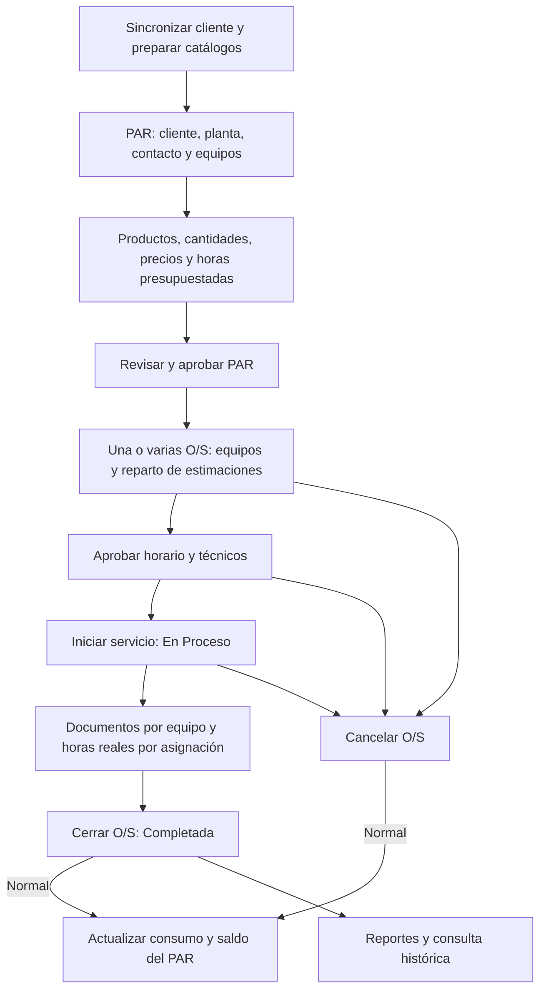

# Flujo del negocio y vocabulario

> Vigente · actualizado el 31 de octubre de 2026: variante de garantía. [Índice](../README.md)
> Fuentes: políticas PAR/O/S, repositorios de ambos documentos y cierre, esquema y rutas de reportes.

## El eje de Maquitech

**PAR y Órdenes de Servicio son los documentos principales de la aplicación.** El PAR reúne lo que se propone realizar y cotizar; la O/S organiza y registra su ejecución. Los módulos de apoyo existen alrededor de ese recorrido.

La información del PAR se usa para cotizar al cliente. El portal no implementa un flujo independiente de aprobación de cotizaciones; la O/S admite su número de referencia.

## Variante de garantía

Una garantía crea otra O/S desde una Completada o desde una referencia externa. Siempre necesita PAR aprobado; si falta el histórico se crea un PAR de referencia con importes y presupuesto cero. Conserva estados, agenda y expediente, con horas independientes y motivo/trabajos propios. La O/S original permanece cerrada. [Flujo de garantías](../modulos/garantias.md). Los efectos presupuestarios de la tabla siguiente corresponden a órdenes normales.

## Etapas y efectos

| Etapa | Actor / condición | Lee | Escribe / resultado | Qué sigue |
|---|---|---|---|---|
| Preparar datos | Rol autorizado del catálogo; Saint para clientes | Identidad comercial y ubicación | Catálogos compatibles | PAR selecciona relaciones válidas |
| Crear PAR | Usuario con acceso al módulo | Catálogos, productos, plantilla opcional y tasa | Cabecera, equipos, ítems, totales; Creado | Revisión, edición o eliminación permitida |
| Aprobar PAR | Superadministrador, Administrador o Supervisor | PAR creado | Aprobado y datos de aprobación | Habilita nuevas O/S |
| Crear O/S | Acceso a órdenes; PAR guardado Aprobado | Equipos, saldo por renglón, técnicos activos | Pendiente, alcance y estimaciones | Reserva presupuesto y bloquea edición PAR |
| Aprobar O/S | Roles aprobadores; horario y reparto válidos | Agenda y conflictos | Aprobada y sello de aprobación | Aparece en calendario |
| Iniciar servicio | Acceso a órdenes; Aprobada | Programación original | En Proceso | Se prepara el expediente |
| Preparar cierre | Superadministrador, Administrador, Supervisor o Coordinador | Equipos y asignaciones programadas | Archivos/No aplica, horas reales y notas en borrador | Todavía consume estimaciones |
| Cerrar O/S | Roles aprobadores; expediente completo | Requisitos, archivos y saldo actualizado | Completada, fecha/actor y reales confirmadas | Consumo real; libera diferencia o registra exceso |
| Consultar / reportar | Rol autorizado | Datos operativos y cierres confirmados | PDF temporal o vista | No altera presupuesto ni estado |
| Cancelar | Acceso a órdenes; estado no terminal | O/S y PAR bloqueados en transacción | Cancelada, historial conservado | Libera reserva y sale de agenda |

Los permisos detallados están en [seguridad](../arquitectura/seguridad-permisos.md). No todos los módulos tienen un proceso de aprobación: los catálogos siguen alta → edición → consulta → baja/inactivación según su implementación.

## Vocabulario común

| Término | Significado |
|---|---|
| PAR | Documento base comercial y operativo: alcance, equipos, productos y presupuesto |
| O/S | Orden dependiente de un PAR; puede cubrir un subconjunto de sus equipos |
| Renglón | Ítem individual del PAR, con identidad propia aun si repite producto |
| Producto que requiere técnico | Servicio cotizable marcado con requires_technician; no es una persona |
| Técnico | Persona registrada en technical; puede tener usuario de acceso vinculado |
| Asignación | Relación O/S + renglón del PAR + técnico + estimación y, después, horas reales |
| Horas presupuestadas | Cantidades de renglones PAR que requieren técnico |
| Horas estimadas | Reparto reservado al programar la O/S |
| Horas reales | Tiempo reportado por asignación; confirmado al cerrar |
| Horario | Inicio/fin programados; no equivale a horas de mano de obra |
| O/S activa para bloquear PAR | Cualquier O/S no cancelada, incluidas las completadas |
| Estado visible PAR | Resultado calculado según sus órdenes; puede diferir del estado guardado |
| Snapshot | Copia de datos guardada para conservar el contexto de una asignación o documento |
| Histórico incompleto | Registro anterior sin el detalle necesario; no se rellena con ceros ficticios |

## Continuidad y excepciones

- Un PAR tiene varias órdenes; cada una conserva sus equipos, técnicos, estimaciones y expediente.
- Finalizado es un estado visible del PAR cuando todas sus O/S normales no canceladas están completadas (garantías si el PAR es de referencia). No es una transición manual que consuma automáticamente todo el presupuesto.
- Cancelar todas las órdenes permite reevaluar la edición del PAR aprobado con los roles correspondientes.
- Exceso real se justifica al cierre; no aumenta las cantidades cotizadas ni modifica importes del PAR.
- Los cierres anteriores sin datos confirmados se conservan como históricos.
- No existe reapertura de O/S, facturación automatizada ni cálculo de comisiones en este flujo.

Detalle: [PAR](../modulos/par.md) · [O/S](../modulos/ordenes-servicio.md) · [horas](../modulos/horas-tecnicos.md) · [cierre](../cierre-orden-servicio.md).
